<picture>
  <source media="(prefers-color-scheme: dark)" srcset="assets/hero-dark.svg">
  <source media="(prefers-color-scheme: light)" srcset="assets/hero-light.svg">
  
</picture>

### About me

I'm an AI / ML engineer from Istanbul. I learn best by building, so this profile is where I work on side projects that push me into areas I want to get better at. I like taking a paper or an idea and making it run end to end, then measuring where it breaks.

### What I'm into

- **Agentic AI**: LLM agents that plan and use tools, and connecting them to real data through the Model Context Protocol (MCP).
- **Computer vision**: object detection and perception, from on-device models on a Jetson Nano to vision transformers.
- **3D from images**: reconstructing 3D objects from one or a few photos. I'm currently training a transformer-based model for this from scratch on a single GPU.

### Featured projects

| Project | What it is |
|---|---|
| [**image-to-3d-lrm**](https://github.com/EnesUguzz/image-to-3d-lrm) | Transformer LRM that turns 1 or 4 photos into a 3D mesh through a triplane NeRF. Trained from scratch on 12k Objaverse objects. `Python` `PyTorch` |
| [**masa-oyunlari**](https://github.com/EnesUguzz/masa-oyunlari) | Online Okey 101 with a smart bot. React + Node monorepo with Playwright end-to-end tests. `TypeScript` |

### Tech

  

Also: LangChain · LangGraph · MCP · Hugging Face · RAG · PEFT / LoRA

### Contact

  
  

